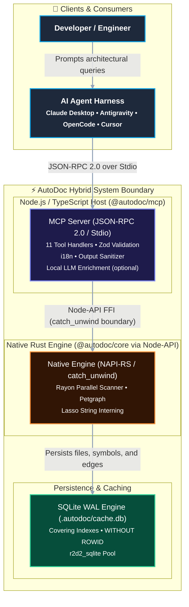

# Reference: System Architecture Specification

Low-level technical specification of the AutoDoc hybrid Rust/TypeScript stack.

---

## High-Level Topology

AutoDoc employs a two-tier architecture:
1. **TypeScript MCP Layer (`packages/autodoc-mcp`)**: Implements the Model Context Protocol JSON-RPC 2.0 lifecycle over `stdio`, schema validation via Zod, and output formatting.
2. **Rust Core Engine (`crates/autodoc-core`)**: Handles compute-intensive operations (tree traversal, string interning, graph algorithms, and SQLite storage) exposed via NAPI-RS native bindings.



---

## Memory Allocation and Footprint (<100MB RSS)

To process repositories with millions of lines of code without exhausting agent memory:
- **String Interning**: Repeated identifiers (package names, file paths, symbol signatures) are interned using `lasso::ThreadedRodeo`. Interned tokens are represented as compact `u32` keys.
- **Compact Graph Nodes**: Petgraph nodes use a plain-old-data (POD) representation sized at 20 bytes per node:
  ```rust
  #[repr(C)]
  pub struct CompactNode {
      pub file_id: u32,
      pub symbol_id: u32,
      pub kind: u8,
      pub flags: u8,
      pub start_line: u32,
      pub end_line: u32,
  }
  ```
- **Custom Global Allocator**: `mimalloc` replaces the system allocator for concurrent multithreaded allocation.

---

## Snapshot Storage: SQLite

AutoDoc stores repository state in `.autodoc/cache.db` as immutable scan generations. `scan_runs` records each attempt and its diagnostics; `scan_state` tracks the active complete generation separately from the latest attempt. A complete scan is staged before publication, and readers pin a `scanId` so a query or page sequence cannot combine generations.

The current schema includes generation-qualified `generation_files`, `generation_symbols`, and `generation_edges`; inventory and evidence projections use `inventory_files`, `facts`, `evidence`, and `relations`. `generation_fts` is updated in the same publication transaction. Legacy mutable tables may remain for migration diagnostics, but they are not a source for a verified current snapshot. A schema migration must reject a newer `user_version` before changing the database.

---

## Polyglot AST Engine & Heuristic Language Support

AutoDoc employs a tiered static parsing architecture:
1. **Tree-sitter extraction**: TypeScript/JavaScript, Python, Rust, Go, Java, and C have AST-backed symbol/call extraction. Confirmed calls require supported syntax, an unambiguous same-file declaration, and no detected shadowing binding. Receiver dispatch, imports, overload resolution, and complete lexical scopes remain unsupported or ambiguous where the parser cannot prove a target.
2. **Heuristic extraction**: Other language analyzers and fallback patterns are candidates with limited coverage. They do not become confirmed call relations solely because a name matches. Diagnostics and coverage states expose unsupported or partial analysis.
3. **Cyclomatic Complexity**: Measures control flow branching complexity ($CC = 1 + \text{decision points}$) by scanning `if`, `for`, `while`, `catch`, `&&`, `||`, `match`, and `case` tokens, weighting key components in C4 Level 3 diagrams.

---

## Dynamic C4 Synthesis & Realtime Contract Discovery

- **Level 1 (Repository Context)**: Identifies the analyzed repository boundary; external actors and services are not inferred without supporting facts.
- **Level 2 (Infrastructure Inventory)**: Projects declared workspace packages, internal dependencies, and detected container services from the selected snapshot. Missing evidence is partial or unsupported coverage.
- **Level 3 (Repository Structure)**: Shows inventoried files and module relationships; it does not claim responsibility-level components when facts are unavailable.
- **Level 4 (Code)**: Projects indexed symbols and resolved call relations from one scan generation. Unresolved calls remain candidates, not confirmed edges.
- **Realtime Contracts**: The `RealtimeAnalyzer` reports discovered events and payload types from snapshot source. Heuristic discoveries remain subject to the response coverage and diagnostics.

---

## Living Diátaxis Documentation Generation

The MCP export handler fixes one repository snapshot for the `DiataxisGenerator`. Current output includes architecture/explanation reports and maps, reference catalogs for endpoints, socket events and data models, and a getting-started tutorial when a package manager is detected. The generator does not currently emit How-To guides.

## Optional Local LLM Enrichment Layer

When a local GGUF model is configured (see [ADR-006](../decisions/adr-006-local-llm-enrichment.md)), an enrichment layer augments — never replaces — the deterministic pipeline:

1. **Model resolution** (`src/llm/`): operator override > hardware auto-selection (largest profile fitting min(free VRAM, free RAM), 15% margin) > deterministic fallback.
2. **Two-pass advisory review**: static pass-1 results remain the source of truth; ambiguous candidates (e.g. routes without a resolved mount prefix) may receive LLM annotations, without removing static candidates or relations.
3. **Structured output**: schema-constrained JSON generation with Zod validation and one repair retry; unparseable output is never accepted.
4. **Anti-hallucination boundary**: LLM output is restricted to descriptions, summaries and refinements validated against static evidence; paths, parameters, schemas and $refs always come from deterministic analysis.
5. **Fallback guarantee**: LLM unavailability or timeout preserves the deterministic output for the affected tool (`llmEnriched: false`).

